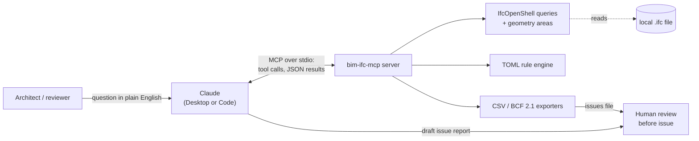

# bim-ifc-mcp

An MCP server that lets Claude (Desktop or Code) open IFC building models and run deterministic
checks on them: room areas, door widths and fire-door data against a configurable TOML rule set, with
the issues exported as CSV for Excel or as BCF 2.1 for BIM review tools.

The design rule is **"model proposes, code executes"**. IfcOpenShell code reads the model and computes
every number and every PASS / FAIL. Claude only chooses which tool to call, explains the results and
drafts the issue list. A qualified person reviews the draft before anything leaves the studio. The
server's instructions tell the model never to estimate or recompute numbers itself, and when the model
data cannot support an answer the result is `UNKNOWN`, not a guess. The point is that a designer can
ask in plain English while the answer stays reproducible: same model in, same answer out.



**Privacy.** MCP was created by Anthropic (November 2024) and is now governed under the Linux
Foundation's Agentic AI Foundation. This server uses the stdio transport: the client starts it as a
local subprocess and the IFC file is parsed on your machine. The model never receives the IFC file; it
receives only the tool definitions and the tool inputs and outputs we choose to return, and this
server makes no network calls.

## Tools

| Tool | What it returns |
|---|---|
| `model_summary(ifc_path)` | Schema, project name, storeys, counts of storeys, spaces, doors, windows, walls and slabs |
| `list_spaces(ifc_path)` | Rooms with number, name, storey, `area_m2` and `area_source`: a NetFloorArea quantity, else GrossFloorArea, else `geometry:footprint` computed from the space shape; `null` if none of these exist |
| `door_schedule(ifc_path)` | Mark, raw tag, type, storey, width and height in mm, fire rating, self-closing, fire exit, external, and the fire rating of the host wall |
| `check_door_widths(ifc_path, min_width_mm=850)` | PASS / FAIL / UNKNOWN per door plus a summary |
| `run_rules(ifc_path, rules_path=None)` | Summary, per-rule counts (including `checked`) and every FAIL / UNKNOWN issue; packaged default rules when no path is given |
| `export_issues(ifc_path, out_path, format, rules_path=None)` | Runs the rules and writes `.csv` or `.bcf` / `.bcfzip`; returns the path, issue count and summary |

The first five tools are annotated read-only. `export_issues` is the only one that writes, and it
overwrites `out_path`. Two prompts package common requests: `door_issue_list(ifc_path)` and
`issue_report(ifc_path, rules_path="")`. Both tell Claude to use only returned data and to include
reviewer notes; `issue_report` then offers a CSV / BCF export. Missing files, unreadable `.ifc` files
and invalid rule files come back as `ToolError` messages the model can relay, not as bare crashes.

## Quickstart

Needs [uv](https://docs.astral.sh/uv/) and Python 3.12 or newer (`.python-version` pins 3.12).

From the repo root:

```bash
uv sync                                   # .venv with runtime + dev (pytest) deps from uv.lock
uv run pytest -q                          # 99 passed, 17 skipped (real models not fetched yet)
uv run python scripts/fetch_samples.py    # optional: two public models into models/external/
uv run pytest -q                          # 116 passed
```

Try the engine without Claude:

```bash
uv run python -c "
from bim_ifc_mcp import ifc_queries as q, rules as r
print(r.run_rules(q.open_model('models/sample_house.ifc'), r.load_rules())['summary'])"
# {'PASS': 3, 'FAIL': 5, 'UNKNOWN': 1}
```

> **Tip:** if the repo path contains a colon (e.g. `BIM:IFC MCP server`), `uv run` fails with
> ``error: path segment contains separator `:` ``. `uv sync` still works, so call `.venv/bin/python` and
> `.venv/bin/pytest` directly, or work from a colon-free path.

### Register with Claude Code

From the repo root (the default scope is this project only; add `-s user` to make it available everywhere):

```bash
claude mcp add bim-ifc -- "$PWD/.venv/bin/bim-ifc-mcp"
claude mcp get bim-ifc        # Status: ✔ Connected
```

### Register with Claude Desktop (macOS)

Edit `~/Library/Application Support/Claude/claude_desktop_config.json` (Settings → Developer → Edit
Config), use the absolute path to the entry point, then quit and restart Claude Desktop:

```json
{
  "mcpServers": {
    "bim-ifc": {
      "command": "/absolute/path/to/bim-ifc-mcp/.venv/bin/bim-ifc-mcp"
    }
  }
}
```

## Usage examples

The tools take absolute paths. Things to ask Claude:

- "Summarise `/…/models/external/Duplex_A_20110907.ifc`: storeys, rooms and doors."
- "List the rooms on Level 2 with their areas and say where each area came from."
- "Which doors are narrower than 850 mm? Give me a table by storey with mark and width."
- "Run the default rules and explain each UNKNOWN: what data is missing and who should fix it?"
- "Run `/…/rules/fzk_haus_de.toml` against `AC20-FZK-Haus.ifc` and compare it with the default rules."
- "Export the issues as BCF to `~/Desktop/duplex-issues.bcfzip` and as CSV next to it."

In Claude Code the prompts are slash commands: `/mcp__bim-ifc__issue_report <ifc_path>` and
`/mcp__bim-ifc__door_issue_list <ifc_path>`.

## Rules

Thresholds live in TOML, not in code, so a project can tune them without touching Python. The
packaged [`default_rules.toml`](src/bim_ifc_mcp/default_rules.toml) holds example screening rules;
pass another file as `rules_path`.

```toml
name = "Project screening rules"                 # required
description = "Stricter door width and larger bedrooms than the defaults (example values)."
placeholder_values = ["Fire Rating", "TBC"]      # text exporters leave instead of real data

[[rules]]
id = "DOOR-WIDTH-920"                            # id, type, title required
type = "door_min_width"
title = "Door width >= 920 mm"
severity = "major"                               # critical | major | minor | info (default major)
reference = "Project brief (example)"
min_width_mm = 920

[[rules]]
id = "BEDROOM-AREA"
type = "space_min_area"
title = "Bedroom floor area >= 10.2 m2"
min_area_m2 = 10.2
name_pattern = 'bed|schlaf'                      # regex as a TOML literal string
```

| Rule type | Parameters | Checks |
|---|---|---|
| `door_min_width` | `min_width_mm` | `IfcDoor.OverallWidth`; UNKNOWN when the width is missing |
| `space_min_area` | `min_area_m2`, optional `name_pattern` (case-insensitive regex on room number and name) | Room area from `list_spaces`; geometry areas are tagged `[area from geometry]` |
| `fire_door_self_closing` | none | Doors with a FireRating must have `SelfClosing = true`; UNKNOWN if not recorded or the rating is a placeholder |
| `door_in_fire_wall_rated` | none | Doors whose host wall (door → opening → wall) has `Pset_WallCommon.FireRating` must carry a rating of their own |

Validation is strict on purpose. Unknown keys are rejected, so a typo such as `name_patern` cannot
silently widen a rule to every room. Thresholds must be finite positive numbers. A rule with
`checked = 0` matched nothing, and the report says so rather than counting it as a pass.

The default rules cite standards as **example** thresholds, with wording checked against the sources:

- AS 1428.1-2009 cl. 13.2: doorways on an accessible path need a clear opening (door open) of at
  least 850 mm. The example rule screens every door. NCC 2025 references AS 1428.1:2021, so confirm
  the edition that applies.
- Victoria Planning Provisions cl. 58.07-1, Standard D26 / Table D11: bedrooms at least 3.0 × 3.0 m,
  main bedroom 3.0 × 3.4 m. The standard sets dimensions; the 9.0 m² rule is an area proxy.
- NCC 2022 Vol. One Part C4 (e.g. C4D5, C4D6): requires self-closing or automatic-closing fire doors.
  Doorsets must comply with AS 1905.1 via Specification 12. Specification 5 sets wall FRLs; it does not
  regulate openings.

## Exports

**CSV** is written as UTF-8 with a BOM so Excel keeps names such as "Küche" intact. Columns: `rule_id,
severity, status, storey, ifc_class, element, element_name, global_id, message, rule_title, reference`.

**BCF 2.1** (`.bcf` or `.bcfzip`) writes one topic per FAIL or UNKNOWN issue:

- TopicType `Error` for FAIL and `Request` for UNKNOWN (missing data is a question for the modeller,
  not a confirmed defect); Priority from the rule severity.
- The element is selected by its IFC GlobalId. The viewpoint frames the element's geometry: a
  clipping plane 0.2 m above a door head (or through a room at 1.5 m) hides the floors above, and
  the perspective camera looks down from whichever side has the clearest sight lines, tested by ray
  casting against the triangulated model, from a door's foot up and with a 0.15 m margin over cut wall
  tops. It turns or steepens (50, 65 or 80 degrees) until a wall in front no longer hides the door.
  Each viewpoint carries a plain grey placeholder snapshot.
- Topic GUIDs are uuid5 of `rule_id|GlobalId`, so a re-export reuses the same topic GUIDs and tools
  that match topics by GUID can update them instead of duplicating them. In BIMcollab Zoom a second
  import of the same file still shows 20 topics, not 40.
- Elements follow the order of the official BCF 2.1 XSDs, characters XML forbids are replaced with
  spaces, and the header names the IFC file and its own timestamp. Every topic says it needs review
  by a qualified person.

BCF is buildingSMART's open, vendor-neutral issue format, not a Revit or Bluebeam format. Where it is
documented to work:

| Tool | BCF support |
|---|---|
| Solibri | Native: exports Presentations as BCF (1.0 to 3.0) and creates Presentations from BCF files |
| Archicad | Native: Issue Organizer imports and exports BCF |
| Revit | No built-in BCF; use the free BIMcollab BCF Manager add-in (published by BIMcollab) |
| Navisworks | Not native; BIMcollab BCF Manager for Navisworks |
| BIMcollab Zoom (free viewer) | Tested with this exporter: imports the topics, a double-click opens the viewpoint with the element selected |
| Bluebeam Revu | No documented BCF support; hand off the CSV or a marked-up PDF instead |

**Tested in BIMcollab Zoom 9.9 (build 9.9.3, Issues panel 7.2.96.0) on macOS, 2026-10-05:** the Duplex export imports as 20 topics, re-importing it updates them rather than
adding 20 more, and a double-click on a topic jumps to its door with the floor above cut away, the
whole door in view and the door selected. Getting there took three rounds; see "What real data
taught me". The other tools in the table have not been tested with this exporter.

## Results on real models

Measured on 2026-10-04 (Apple M4 Pro, Python 3.12.12, ifcopenshell 0.9.0). Times are a fresh process,
median of 3, and exclude package import (~79 ms). "Repeat call" is the median of 5 calls on the cached model.

| Model | Exported by / schema | Size | Spaces / doors | Area source | Default rules PASS / FAIL / UNKNOWN | Issues = BCF topics | First `run_rules` (open + run) | Repeat call |
|---|---|---|---|---|---|---|---|---|
| `sample_house.ifc` | IfcOpenShell 0.9.0 / IFC4 | 10.6 kB | 5 / 5 | 4 NetFloorArea, 1 geometry | 3 / 5 / 1 | 6 | 32 ms | 1.1 ms |
| `sample_house_ifc2x3.ifc` | IfcOpenShell 0.9.0, Revit-like / IFC2X3 | 14.6 kB | 5 / 5 | 5 geometry | 3 / 5 / 1 | 6 | 58 ms | 1.1 ms |
| `Duplex_A_20110907.ifc` | Revit Architecture 2011 / IFC2X3 | 2.4 MB | 21 / 14 | 21 geometry | 12 / 6 / 14 | 20 | 103 ms | 8.4 ms |
| `AC20-FZK-Haus.ifc` | ArchiCAD 20 / IFC4 | 2.6 MB | 7 / 5 | 7 BaseQuantities.NetFloorArea | 5 / 0 / 0 | 0 | 37 ms | 3.6 ms |

The Duplex issues are 6 doors under 850 mm (A102 and B102 at 813 mm; A104, B104, A205 and B205 at
762 mm) and 14 UNKNOWN fire-door checks. All 4 bedrooms pass at 22.04 m², with the area taken from
geometry. On FZK-Haus the default bedroom rule checks no rooms (`checked = 0`). With
`rules/fzk_haus_de.toml` it checks one room, Schlafzimmer at 21.41 m², which passes.

### What real data taught me

- **Revit exports may carry no standard area quantities.** None of the Duplex's 21 spaces has a
  NetFloorArea or GrossFloorArea in `Qto_SpaceBaseQuantities` / `BaseQuantities`. The only exported
  area quantity is the US GSA set's "GSA BIM Area", which equals Revit's `Area` parameter and which
  the server does not read. So areas fall back to the geometry footprint. The source is always
  labelled, and the standard quantities win when present.
- **A library helper returned 0.0 for real rooms.** `ifcopenshell.util.shape.get_footprint_area` gave
  0 for the Duplex's two surface-model hallways (A201, B201). The server now unions the XY projection
  of every non-vertical triangle with shapely (6.89 m² each). A zero is never reported as an area.
- **Footprint is a gross screening measure, not a regulatory area.** On the Duplex the footprint
  matches Revit's own `Volume / extrusion depth` for all 17 vertically extruded spaces (max 0.29 %
  difference, from 2-dp rounding). It is still 6.8–22.8 % below Revit's `Area` parameter (375.71 vs
  422.05 m² in total). On FZK-Haus it matches ArchiCAD's GrossFloorArea to within 0.039 %. The
  NetFloorArea values follow ArchiCAD's own definitions: 3.0 % below gross for five rooms, equal for
  Küche, and 74.51 vs 107.16 m² for the sloped-roof Galerie. Hence `area_source` and the
  `[area from geometry]` flag.
- **Tag is not the door mark.** Revit writes its ElementId into `IfcDoor.Tag` (e.g. 146596). The
  drawing mark (A101) is the `Mark` property in `PSet_Revit_Identity Data` / `Identity Data`, so
  `mark` uses it and the raw `tag` is kept. ArchiCAD's Tag is a GUID-like string.
- **Placeholders are not data.** Revit 2011 exported the literal text "Fire Rating" as the FireRating
  of all 14 Duplex doors. `placeholder_values` turns that into 14 actionable UNKNOWNs instead of
  14 apparent fire doors.
- **Placement is not location.** Revit placed 19 of the Duplex's 21 IfcSpaces at their storey origin
  (all except the two surface-model hallways), so the placement does not locate a room. BCF cameras
  aim at the geometry's bounding-box centre.
- **A schema-valid BCF is not enough; test it in the tool.** BIMcollab Zoom imported the first export
  but would not open any viewpoint ("This issue has no viewpoint to zoom to") until each topic carried
  a `snapshot.png`, which the BCF 2.1 schema makes optional (the same bug as IfcOpenShell issue #7152).
  The next camera, at a fixed offset, sat inside the floor above door A104; the one after that left
  the door's foot behind a wall whose cut top the sight line only grazed. Clipping planes, ray-cast
  side selection from the door's foot up and a 0.15 m margin fixed both, and a test now checks every
  Duplex topic for a clear view.
- **Naming conventions differ between projects.** The German FZK-Haus room names match nothing under
  the default `bed` pattern. The report shows `checked = 0` instead of an empty pass, and a project
  rule file fixes it without code changes.

## Testing

```bash
uv run pytest -q                                   # full suite: 116 tests, about 7 s
uv run pytest -q tests/test_real_models.py -rs     # shows "run scripts/fetch_samples.py" when models are absent
uv run python scripts/make_sample.py               # regenerate the two fixture models
uv run python -m ifcopenshell.validate models/sample_house.ifc   # fixtures validate with 0 errors
```

| File | Tests | Covers |
|---|---|---|
| `test_rules.py` | 35 | Rule engine and CSV export on hand-written rows (no IFC file): PASS / FAIL / UNKNOWN paths, placeholders, validation errors |
| `test_queries.py` | 16 | Summary, spaces, door schedule, units, Revit marks, in IFC4 and IFC2X3 |
| `test_bcf.py` | 20 | Zip structure, XSD element order, stable GUIDs, framed and unobstructed viewpoints, snapshots, XML-invalid characters |
| `test_real_models.py` | 15 | Pinned numbers on the Duplex and FZK-Haus (skipped when the models are absent) |
| `test_server.py` | 14 | End to end over MCP with an in-process client: tool list, annotations, `ToolError` paths, prompts |
| `test_rules_integration.py` | 10 | Default rules, CSV and BCF on both fixtures, also over MCP; the same 6 issues whichever schema |
| `test_geometry.py` | 6 | Footprint fallback, face orientation, spaces without geometry |

The fixtures come from `scripts/make_sample.py`: one building in IFC4 (with quantities) and IFC2X3
(Revit-like: geometry only, doors typed by IfcDoorStyle). Their answers can be checked by hand.
`scripts/fetch_samples.py` downloads the two real models and pins each by SHA-256; it skips files that
already match. 17 tests need those models.

## Limitations

- **Screening, not certification.** Thresholds are examples; confirm them against the project's NCC,
  AS and planning requirements.
- **OverallWidth is not the clear opening.** It is the overall (nominal) door width, and Revit exports
  the family's Width. It is never smaller than the clear opening, so a FAIL is definite and a PASS
  only means "not ruled out; confirm clear opening".
- **Footprint is not a regulatory area,** and an area rule only approximates a dimensional standard.
- **Results depend on exported data.** Fire rules need `Pset_DoorCommon` / `Pset_WallCommon` values;
  the Duplex has no wall fire ratings, so FIRE-DOOR-02 checks 0 doors there. Room rules depend on naming.
- **Narrow scope.** Doors and spaces only. Tested on IFC2X3 and IFC4. BCF 2.1 only. Each topic's
  snapshot is a plain grey placeholder, not a rendered view (BIMcollab will not open a viewpoint
  without one).
- **Local trust model.** The server runs with your permissions and opens any path it is given.
- **Why not IDS?** buildingSMART IDS 1.0 (final, June 2024) checks properties, attributes,
  classifications and exported quantities. It explicitly cannot do geometry or computed values. It
  could require NetFloorArea, but on the Duplex it could only report all 21 as missing. It could
  bound the exported GSA BIM Area (Revit's `Area`), but it cannot compute a footprint. IDS fits
  data-completeness requirements; this server adds computed and cross-element checks.

## Project layout

```
src/bim_ifc_mcp/
  server.py            MCP tools, prompts and error handling      (196 lines)
  ifc_queries.py       spaces, doors, units, Revit marks          (180)
  geometry.py          footprint areas, bboxes, sight lines       (130)
  rules.py             TOML rule engine and validation            (235)
  default_rules.toml   example screening rules                    (56)
  export.py            CSV export                                 (23)
  bcf.py               BCF 2.1 writer                             (361)
rules/fzk_haus_de.toml project rule set for German room names
scripts/               make_sample.py (fixtures), fetch_samples.py (real models)
models/                two generated fixtures; external/ holds fetched models (gitignored)
tests/                 116 tests
```

## Sample models

The real models are not committed; `scripts/fetch_samples.py` downloads them unmodified into `models/external/`.

- `Duplex_A_20110907.ifc`: BSI (2020) "Duplex Apartment Test Files", buildingSMART International,
  <https://github.com/buildingsmart-community/Community-Sample-Test-Files>, licensed under
  [CC BY 4.0](https://creativecommons.org/licenses/by/4.0/). No changes made.
- `AC20-FZK-Haus.ifc`: Karlsruhe Institute of Technology (KIT), Institute for Automation and Applied
  Informatics (IAI), provided for unrestricted use, <https://www.ifcwiki.org/index.php?title=KIT_IFC_Examples>.
- `models/sample_house*.ifc`: generated by this repo's `scripts/make_sample.py`.
